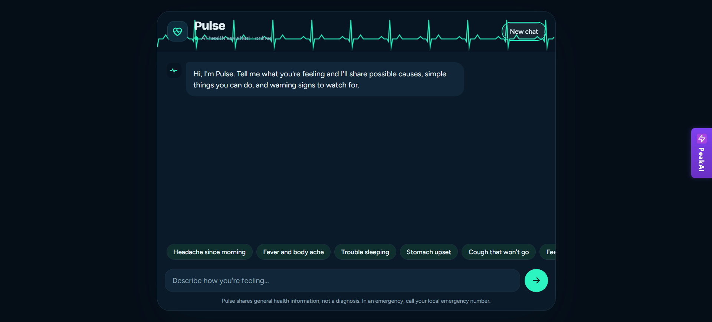
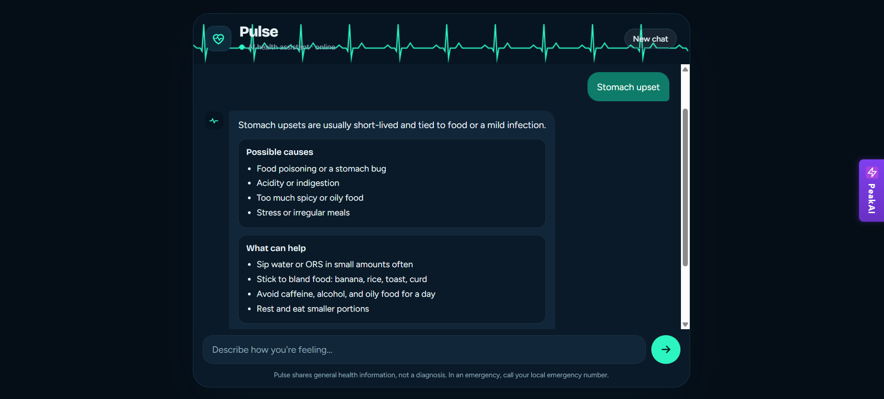
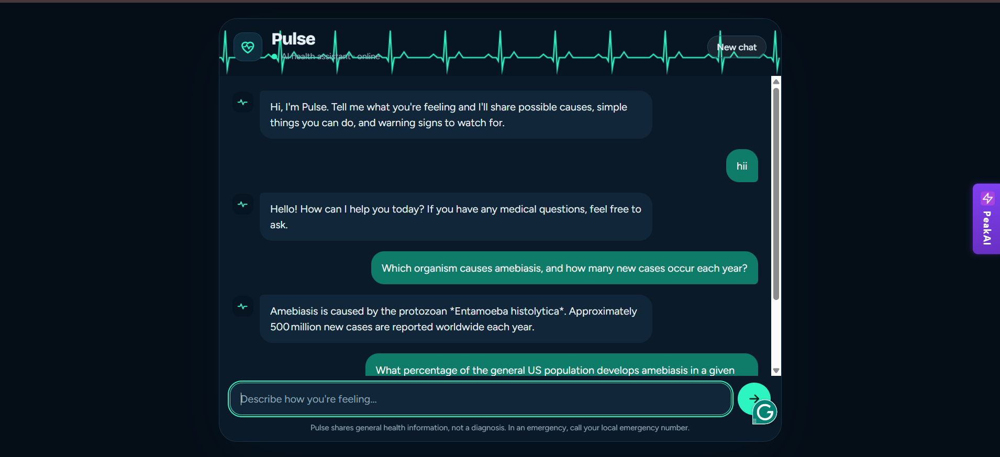

# 🩺 Pulse: AI-Powered Medical Chatbot

An end-to-end GenAI medical assistant that answers health-related questions using Retrieval-Augmented Generation (RAG). Describe a symptom or ask about a disease, and **Pulse** responds with possible causes, simple things you can do, and warning signs to watch for. Answers are grounded in a medical reference book instead of being made up by the LLM. Built with a FastAPI backend, a React (Vite) frontend, Pinecone vector search, and Groq-powered LLM inference.

> ⚠️ **Disclaimer:** Pulse shares general health information only. It is **not** a diagnosis or a substitute for a doctor. In an emergency, call your local emergency number.

## 🧑‍⚕️ About the Project

This project simulates a conversation with a friendly AI health assistant. You can:

- 🤒 Describe symptoms ("Headache since morning", "Fever and body ache", "Cough that won't go")
- 📖 Ask medical questions about diseases, causes, organisms, and treatments
- ✅ Get structured answers: **Possible causes** and **What can help**
- 🚨 See warning signs that mean you should visit a doctor
- 💬 Ask follow-up questions in the same chat, or start fresh with **New chat**

Answers come from a medical book (`data/Medical_book.pdf`) that is chunked, embedded, and stored in Pinecone. At query time, the most relevant chunks are retrieved and passed to the LLM along with a carefully designed medical prompt.

## ✨ Features

- 🤖 RAG-based medical Q&A grounded in a trusted medical book
- 🧠 Context-aware conversation (follow-ups work naturally)
- 🧾 Clean, structured responses (possible causes, home care, red flags)
- 💡 Quick-start suggestion chips for common symptoms
- 🌙 Modern dark UI with a heartbeat-style header animation
- ⚡ Fast inference through Groq
- 🔐 API keys managed through `.env`

## 🛠️ Tech Stack

| Layer          | Technology                                      |
|----------------|-------------------------------------------------|
| LLM Engine     | Groq (and OpenAI, configurable)                 |
| Embeddings     | Hugging Face sentence-transformer embeddings    |
| Vector DB      | Pinecone                                        |
| Orchestration  | LangChain (RAG pipeline)                        |
| Backend        | FastAPI                                         |
| Frontend       | React (Vite)                                    |
| Knowledge Base | Medical reference book (PDF)                    |

## 📂 Project Structure

```bash
medical-chatbot-genai/
├── data/
│   └── Medical_book.pdf      # Source knowledge base
├── frontend/                 # React (Vite) UI
│   ├── public/
│   ├── src/
│   ├── index.html
│   ├── package.json
│   └── vite.config.js
├── research/
│   └── trials.ipynb          # Experiments and prototyping
├── src/
│   ├── __init__.py
│   ├── helper.py             # PDF loading, chunking, embeddings
│   └── prompt.py             # System prompt for the medical assistant
├── static/
├── app.py                    # FastAPI backend
├── store_index.py            # Builds the Pinecone index from the PDF
├── setup.py
├── template.sh               # Project scaffolding script
├── requirements.txt
├── LICENSE
└── README.md
```

## 📸 Demo

| Welcome Screen | Symptom Query | Medical Q&A |
|----------------|---------------|-------------|
|  |  |  |

> Save your three screenshots in an `images/` folder at the repo root and rename them to match the paths above (or update the paths).

## ⚙️ Setup Instructions

```bash
git clone https://github.com/aryantiwari7-web/medical-chatbot-genai.git
cd medical-chatbot-genai
python -m venv env
source env/bin/activate  # Windows: env\Scripts\activate
pip install -r requirements.txt
```

Create a `.env` file in the root directory and add the following keys:

```
GROQ_API_KEY=your_groq_key
OPENAI_API_KEY=your_openai_key
HUGGINGFACEHUB_API_TOKEN=your_huggingface_token
PINECONE_API_KEY=your_pinecone_key
```

### Build the Vector Index (one-time)

Put your medical PDF inside `data/`, then run:

```bash
python store_index.py
```

This loads the PDF, splits it into chunks, creates embeddings, and uploads them to your Pinecone index.

## ▶️ How to Run

### Start FastAPI Backend

```bash
uvicorn app:app --host 0.0.0.0 --port 8000 --reload
```

### Start React Frontend

Open a new terminal:

```bash
cd frontend
npm install
npm run dev
```

The app will be available at `http://localhost:5173` (default Vite port), talking to the backend on port `8000`.

## 💬 Example Queries

- "Stomach upset"
- "Headache since morning"
- "Which organism causes amebiasis?"
- "What are the symptoms of typhoid and when should I see a doctor?"

## 🔮 Future Improvements

- 🌐 Multi-language support (Hindi, English, and more)
- 🎙️ Voice input and speech-to-text
- 🖼️ Upload reports or prescriptions for explanation
- 🧾 Chat history with user accounts and login
- 📚 Support for multiple medical books and sources, with citations in answers
- 🚑 Emergency detection with instant red-flag alerts
- 💊 Medicine information and interaction checks
- 📱 Mobile-first responsive UI
- 🐳 Docker setup and cloud deployment (AWS / Render)

## ⚠️ Medical Disclaimer

Pulse is an educational project. It does not provide medical advice, diagnosis, or treatment. Always consult a qualified healthcare professional for any medical concern.

## 📄 License

This project is licensed under the terms of the [LICENSE](LICENSE) file.

## 👤 Author

**Aryan Tiwari**
GitHub: [@aryantiwari7-web](https://github.com/aryantiwari7-web)